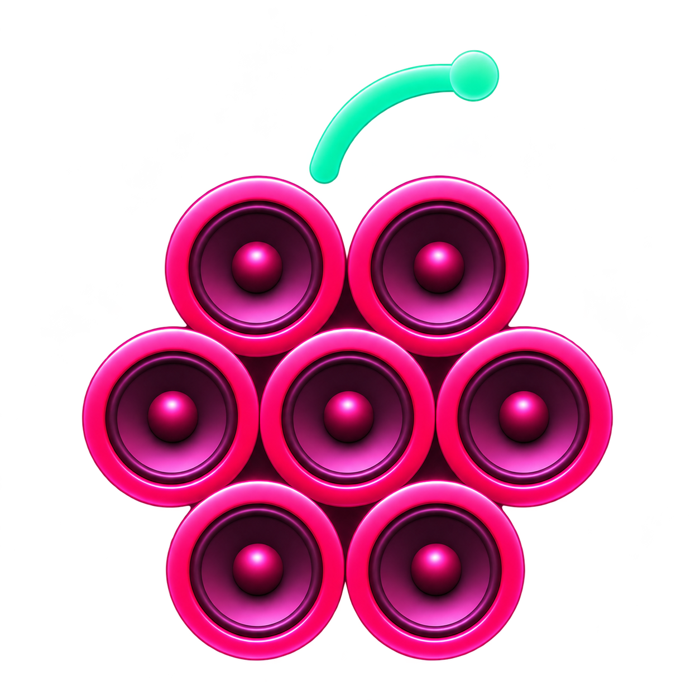

<div align="center">



# Raspiboard

**Your sounds. One click away.**

A desktop soundboard for Linux. Play clips through your speakers,
send them into a call, or do both at once.

<p>
  
  
  <a href="LICENSE"></a>
</p>

[Get started](#get-started) · [How to use](#your-first-sound) · [User guide](docs/user-guide.md) · [Build from source](docs/development.md)

</div>

---

## Make some noise

Raspiboard turns your audio files into a board of playable pads. Choose a
recording application and your clips play alongside its microphone input,
with no virtual microphone to select in that application.

- **Play locally or into a call.** Control what you hear and what the selected
  application receives with separate volume sliders.
- **Make each pad yours.** Set names, colors, relative volume, and a cropped
  playback range with a waveform preview. Original files stay untouched.
- **Stack sounds.** Enable Overlap Mode to layer clips, including repeated
  copies of the same sound. Pause or stop them together.
- **Trigger from anywhere.** Assign desktop-managed global hotkeys and play
  sounds while another application has focus.*
- **Set the mood.** Choose Deck or Console, resize the pads, and drag them
  into the order you want.
- **Pick up where you left off.** Sound assignments, pad order, and settings
  save automatically. Playback always starts stopped.

<sub>*Global hotkeys require a desktop portal backend that supports Global Shortcuts.</sub>

## Get started

**Supported packages:** x86-64 Linux, Debian 13+ and Ubuntu 26.04+.
Choose a `.deb` for an installed application or an AppImage for a portable one.

Find automatically built packages in the artifacts of a successful
[Build Linux packages run](https://github.com/sergix44/raspiboard/actions/workflows/package-linux.yml).
Extract the downloaded archive before installing or launching a package.

### Install the `.deb`

From the directory containing the package:

```sh
sudo apt install ./raspiboard_0.1.0-1_amd64.deb
```

Then open **Raspiboard** from your application menu.

### Run the AppImage

```sh
chmod +x Raspiboard-0.1.0-x86_64.AppImage
./Raspiboard-0.1.0-x86_64.AppImage
```

Use the filename matching your downloaded version. Both formats share the same
settings and sound assignments.

Your desktop needs **PipeWire 0.3.65 or newer**, a session manager such as
WirePlumber, and its usual desktop portal backend for file dialogs. These
normally come with a configured PipeWire desktop. Hotkey support depends on
the portal backend; ordinary pad playback remains available without it.

See the [packaging guide](docs/packaging.md) for checksums, AppImage extraction,
menu integration, removal, and building your own packages.

## Your first sound

1. **Add a clip.** Right-click empty space in the grid and choose **Add Sound**,
   then pick an audio file. To fill an existing empty pad, right-click it and
   choose **Replace sound**.
2. **Choose where it goes.** Select a recording application in the bottom
   dropdown. It appears when that application opens a microphone stream.
   Choose **No Output** to play only through your speakers.
3. **Press a pad.** Click to play. Use the bottom controls to pause, resume,
   or stop playback.
4. **Balance the sound.** **Local Volume** is what you hear; **Remote Volume**
   is what the selected application receives. The chain icon links the sliders.
5. **Make it yours.** Right-click a pad and open **Options** to change its name,
   color, volume, crop, overlap behavior, or hotkey.

Hold the **middle mouse button** on a pad and drag it onto another pad to
reorder the board. Open the **settings cog** to change the theme or pad size.

For crop controls, overlap behavior, shortcuts, and troubleshooting, see the
[user guide](docs/user-guide.md).

## Bring your audio

Play common formats including **WAV, FLAC, MP3, AAC/M4A, Ogg Vorbis, and Opus**,
plus AIFF, ALAC, CAF, MP1/MP2, and supported audio inside MP4 or Matroska/WebM.
Playback supports mono and stereo files up to 384 kHz. Container support depends
on the audio codec inside it.

Your audio stays in its original location. Raspiboard saves references to the
files, so keep them somewhere permanent. Cropping and volume changes affect
playback without editing the source.

## Your board stays yours

Settings and sound assignments live in `~/.raspiboard/`. Both package formats
use that same directory, and uninstalling the `.deb` leaves it intact.
To back up your board, close Raspiboard and copy that directory **along with
your original audio files**. Assignments use absolute paths; moved files need
to be reassigned through **Replace sound**.

Only one instance runs at a time. Launching Raspiboard again leaves the
existing window running.

## For the curious

Built in Rust with [Iced](https://iced.rs/) and PipeWire. Interface text uses
Monaspace Krypton; controls use Lucide icons, both bundled with the application.

| Guide | What's inside |
| --- | --- |
| [Using Raspiboard](docs/user-guide.md) | Pads, playback, shortcuts, and common questions |
| [Development](docs/development.md) | Build dependencies, source builds, checks, and code walkthroughs |
| [Linux packaging](docs/packaging.md) | Build `.deb` and AppImage packages with the PHP tooling |
| [Saved data](docs/saved-data.md) | Settings and category file formats |
| [Acceptance checks](docs/acceptance.md) | Desktop checks for audio, the interface, and packages |

## License

Copyright 2026 Sergio Brighenti. Licensed under [GNU GPL version 3](LICENSE)
(`GPL-3.0-only`). Bundled dependencies and fonts retain their own licenses.
