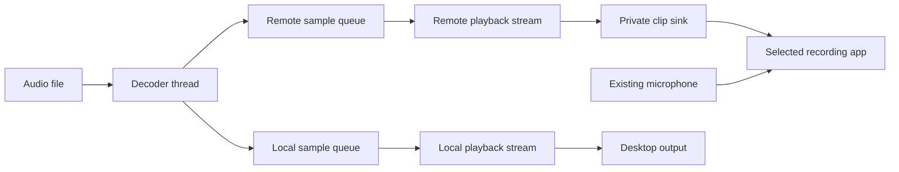

# PipeWire and the audio worker

The audio path is:

The private sink is an internal audio endpoint, not a microphone you select in
your chat application. Its output is connected to the input ports of the selected
recording stream. PipeWire combines the inputs there. A second playback stream
sends the same clip to the desktop's default output with its own volume. With
None selected, only that local stream and sample queue are created; there is no
private sink or remote output.

## Modules and responsibilities

| Module in `src/audio/` | Responsibility |
| --- | --- |
| `mod.rs` | Public commands, snapshots, controller, and iced event subscription. |
| `backend.rs` | PipeWire connection, reconnection, selection, concurrent sessions and group controls. |
| `session.rs` | One instance's decoder, output readiness, pause state, drain and cleanup. |
| `discovery.rs` | Subscribe to native node, port, and link information. |
| `graph.rs` | Interpret that information and find microphone paths and matching channels. |
| `decode.rs` | Read audio packets and convert decoded samples to floating-point values with Symphonia. |
| `job.rs` | Decode once on a worker and feed bounded remote and local sample queues. |
| `buffer.rs` | Fill playback buffers, apply volume, and handle missing samples without waiting. |
| `route.rs` | Own the private sink and links to the chosen application's input ports. |
| `player.rs` | Configure a remote or local playback stream and supply its audio buffers. |

`src/lib.rs` exposes the audio domain to the executable. Keeping it separate from
the interface also allows its tests to run without opening a window.

## Tasks and subscriptions in iced

`update` returns `Task<Message>`. Most messages return `Task::none()` because
they only change state or send a command. Choosing Replace sound from the pad menu returns a task
that awaits the native file dialog and sends `AudioChosen` with the result. Awaiting
releases the interface executor to do other work; it does not freeze the window.

`subscription` uses `Subscription::run(audio::events)` to receive ongoing events.
`Ready` supplies a `Controller`; `Changed` supplies an audio `Snapshot`. The worker
is the authority on available destinations and playback status. The interface
displays snapshots and sends commands, rather than guessing whether a connection
or playback operation succeeded.

`Option<T>` represents a value that may be absent: no destination is `None`, while
a chosen destination is `Some(target)`. `Result<T, String>` represents success or
an error. The `?` operator returns an error to the caller early, so a failed
connection can become a visible message instead of a panic.

## Why PipeWire has its own thread

PipeWire's event loop waits for server messages and dispatches callbacks. Running
it on the interface thread would prevent iced from processing its own events.
Native PipeWire objects also cannot simply be sent between threads. Rust models
that restriction through the `Send` and `Sync` traits.

The audio worker creates and keeps all native objects on one thread. A bounded
command channel carries Play, Preview, Pause, Resume, Stop, Select, and SetVolumes requests into it. Play
carries an optional target; None is accepted only when the confirmed selection
is also None. It also captures the button ID and overlap flag. Preview carries the
button ID but always runs exclusively and locally. A stale local or remote request
cannot use a changed selection. A timer checks commands every 25 milliseconds and publishes changed snapshots.
Sending a command uses `try_send`, so the interface never waits for a full queue.

The worker uses `Rc<T>` for shared ownership within its thread. `RefCell<T>` allows
callbacks to change shared state while checking borrowing rules at runtime. A
conflicting borrow would panic, so each borrow is kept short and released before
another callback runs. Weak references let callbacks refer to their event loop
without creating an ownership cycle that would keep it alive forever.

## Discovering applications without a whitelist

The PipeWire registry reports objects that already exist and later additions or
removals. Listeners also track changes to their properties. The graph stores:

- Nodes: devices, filters, and application streams.
- Ports: a node's individual audio inputs and outputs.
- Links: connections from an output port to an input port.

Removing a node immediately invalidates its ports and incident links; removing
a port invalidates links that reference it. Registry removal callbacks may arrive
separately, and a new sink can reuse a node ID before the old port notifications
finish. Cascading invalidation prevents new overlap instances from linking to
stale ports or seeing an ambiguous channel layout during that interval.

Recording streams use `media.class = Stream/Input/Audio`. Raspiboard traces their
incoming links backwards to find a physical audio source. A visited set prevents
cycles from making this search loop forever. It excludes its own nodes and known
desktop-monitor-only paths; an unresolved source is labelled rather than guessed.

A filtered virtual microphone may expose ports marked as monitors. Those ports
still carry microphone audio. The discovery code therefore considers the source
node's class and upstream links, not the port name alone. A sanitized fixture
from a real effects-chain graph tests this case without requiring EasyEffects.

Each destination carries both a node ID and an object serial. IDs can be reused
when objects disappear. Comparing the serial as well prevents an old selection
from matching a newly created stream with the same ID. Closing the selected
recording stream clears the selection and stops playback.

On each PipeWire connection, `Engine::refresh_targets` selects the first available
target in the graph's node-ID order once discovery returns a nonempty list.
Selection alone does not start playback. The engine records that initialization
so later discovery updates do not override the choice. An explicit Select command,
including None before any applications appear, also completes initialization.
Starting a clip with no target fixes the selection to None as well, so discovering
an application cannot change the destination of an already local-only clip.
Losing the selected stream leaves None selected rather than choosing a replacement.

## Per-sound gain and crop

`Command::Play` snapshots the pad's `PlaybackOptions`. Name/color changes affect
appearance immediately, while gain and crop wait until the next Play. Decoding
counts source frames so Start is inclusive and End exclusive, even across packet
boundaries. When a container reports its frame count, crop validation uses that
count and, for codecs other than MP3, an accurate seek with 100 ms of decoder preroll. The first emitted
packet's timestamp and encoder trim establish the sample position, preserving
crop boundaries across compressed formats. Formats without frame counts retain
the bounded validation scan; failed seeks fall back to decoding from the start.
Default playback skips crop validation. Cancellation remains active throughout scanning,
and routing's timeout starts once decoded outputs are ready to connect.

MP3 keeps its decoder state contiguous from the beginning of the stream, and the
crop producer discards preceding frames with cancellation checks. MP3 reference
packets can depend on earlier bit-reservoir data even after a demuxer preroll;
decoding them after a reset produced underflow warnings in discarded audio.
Sequential warm-up avoids those warnings and preserves exact crop samples.
Its preparation cost increases with the crop position; other codecs retain
their native fast seek path.

Crop start/end are in milliseconds; frame boundaries round up to the first frame
in the interval. The displayed rounded final millisecond is accepted and clamped
to EOF. Fades operate on the selected audio, preserving smooth transitions.
Relative dB gain becomes an amplitude multiplier carried to both output feeds.
The callback multiplies clip, master and transition gains before clamping final
samples, so a quiet master does not clip a boosted intermediate sample.

`audio/waveform.rs` uses the same codec registry for background analysis. It
compacts peaks incrementally to at most 2048 bins and counts decoded frames for
duration, keeping memory bounded without retaining the whole clip. Peak reduction
runs in blocks rather than updating summary bins once per frame. A bounded cache
retains 16 summaries keyed by path, size and modification time; unchanged files
reuse their Arc while changed files are reanalyzed. The cache lock is released
before decoding. Audio codec crates are optimized in development builds as well.

## Decoding without blocking playback

Symphonia enables all built-in codecs and containers and probes the file content, using its extension as a hint. A shared codec registry also registers `symphonia-adapter-libopus` for Opus audio; it follows the same packet, sample, fade, and pause path as built-in codecs. The first decoded packet establishes the sample rate and channels, including formats whose headers omit them. `ClipDecoder` accepts mono or
stereo audio and reports the sample rate. Samples become `f32` values, where
ordinary full-scale audio lies between -1 and 1. Mono frames are duplicated into
left and right channels. PipeWire's adapters perform sample-rate conversion and
mix stereo down to mono when the destination requires it.

Decoding happens on a separate thread because file reads can take unpredictable
amounts of time. The `rtrb` crate provides a fixed-size queue of 16,384 stereo
frames for each active output: always local, and remote only when an application
is selected. At 48,000 frames per second, each holds about a third of a second.
The decoder sends each frame to the active queues in order, bounding memory use
without loading or decoding the entire clip twice. Local-only playback never
allocates an unused remote queue that could fill and stall decoding. Only the
decoder waits when a queue is full; playback callbacks never wait. Cancellation
interrupts that wait even when one output stops consuming.

`SampleFeed::render` copies available frames into PipeWire's buffer and applies
that output's volume. Streams initially supply silence while PipeWire negotiates
connections. Samples remain queued until the local stream is streaming and any
remote links are active; failed links report their error and incomplete
startup has a ten-second timeout. This lets negotiation proceed without consuming
the beginning of the clip. Local playback uses session-manager automatic linking
to the desktop output, while remote playback names its private sink explicitly.
The local stream and private sinks share a `node.link-group` to prevent automatic
local linking to a remote sink; the remote stream is outside that group. See
[PipeWire session-manager properties](https://docs.pipewire.org/page_man_pipewire-props_7.html)
for the native targeting and link-group properties.

Pause requests a 5 ms fade on each active output, then callbacks supply silence
without consuming queued frames. Resume reverses that envelope and continues at
the held position. Decoding may fill the bounded queues while paused, then waits
for consumption or cancellation. Stop takes priority over pause and can complete
without consuming another frame when already silent. Pause applies to every session when the group is playing, including sessions still
loading; it is ignored when the entire group is loading. A session whose output
has finished is allowed to drain instead of pausing. New output callbacks inherit
the session's pause flag, so a pending session cannot become audible after Pause.
Starting another overlapping pad resumes a paused group before adding the new session.

An empty queue produces silence until more samples arrive. At the
end of a file, playback drains every active stream before removing its links.
The producer applies 5 ms fades to the beginning and end, retaining only the final
5 ms until EOF is known. Frame count and source files are unchanged.
Stop and replacement signal a separate 5 ms callback fade. The engine retains
outgoing streams and their routes until they drain, with a three-second cleanup
limit for disconnected outputs. New playback can prepare while the old stream drains.
Readiness, errors, completion, and draining inspect only outputs that exist;
local-only playback never waits for a remote stream. If an active output fails,
its instance stops and reports an error while unrelated instances continue.
A PipeWire connection failure or loss of the selected app stops the whole group.
Core error events carry the affected proxy ID and error code. An ENOENT
(resource already gone) response can be sent on the core when a queued destroy
request races with resource removal. It is an object-lifecycle diagnostic,
not a lost connection; it does not reconnect or cancel the playback group.
Other core errors still fail the connection. Owned sink and link errors are
handled by their session's proxy listeners, avoiding cancellation of unrelated
instances. This follows the distinction in PipeWire's
[native protocol handling](https://github.com/PipeWire/pipewire/blob/1.6.2/src/modules/module-protocol-native/protocol-native.c)
and [connection-error handling](https://github.com/PipeWire/pipewire/blob/1.6.2/src/modules/module-protocol-pulse/manager.c).
Non-finite samples are silenced, and samples outside the normal range are clipped.

`Arc<T>` provides shared ownership across threads. Atomic values communicate
the two independent gains, cancellation, and completion without locking audio
callbacks. Acquire and Release ordering ensure completion is observed after the
producer's preceding work; the volume only needs Relaxed ordering because it is an independent value.
The callback checks end-of-file before reading the queue. Checking it after an
empty read would race with the producer adding its final frame and announcing
completion, potentially discarding that frame. A concurrent regression test
exercises that boundary.

## Ownership and cleanup

Rust drops owned values when their scope ends or their owner replaces them.
The playback object owns the local stream and an optional remote player/route,
including its sink, listeners, and links.
Stop or changing destination moves active playback into the retiring list until
its short fade has drained, then drops those objects. The decoder job's `Drop`
implementation signals cancellation so its thread exits even if the sample queue is full.

Listeners must remain alive while their callbacks are needed. Their fields appear
before the associated native objects so the listeners are removed first when the
owner is dropped. Server objects use `object.linger = false`, so they do not remain
after the owning client disconnects. Raspiboard never deletes existing microphone
links or changes the system's default input device.

If PipeWire disconnects, the worker retries with a fresh graph and selects the
first available destination again. It never resumes the previous clip automatically.

## What the tests establish

Tests exercise discovery and audio processing without a live server: direct and
filtered microphone paths, monitor exclusion, channel mapping, partial stereo
connections, failed negotiation, reused IDs, stale Play commands, repeated
destination selection, PCM decoding, ordered dual-output delivery, independent
gains, cancellation with a full queue, silence on buffer exhaustion, and concurrent
end-of-file behavior. Interface tests also cover volume linking and file assignment.
They cannot establish what another application actually receives or what the
desktop output plays. Those remain the manual acceptance checks.

Options preview sends `Command::Preview` with the valid current crop draft and
saved relative gain. It shares the normal decoder and stream lifecycle but creates
only a local output; it neither requires nor changes the selected recording target.
The Options footer follows the matching preview instance, including loading and
paused states, so Stop remains available even after a draft becomes invalid.
Ordinary pad playback is not treated as an Options preview.

Each playback snapshot includes its source position in milliseconds.
`buffer::PlaybackPosition` counts source frames consumed by `SampleFeed`, using
the decoded sample rate and the crop Start captured when playback begins.
Silence generated while waiting for routing, during an underrun or after the
pause fade does not advance it. `Session::snapshot` reads the local player's
position, which reaches the UI through the existing 25-millisecond worker tick.

For non-overlapping normal playback, sessions publish a `SeekRange` only when
the original cropped duration exceeds 5000 milliseconds. Prepared outputs carry
the decoder's source duration when available; a cancellable `DurationJob` reuses
waveform analysis as a fallback without blocking playback. `Command::Seek`
requires a single eligible session and a matching generation ID. The session
clamps the requested source position to the original crop, replaces its decoder,
and retires old outputs through the usual stop fade. It retains the original
path, crop End, clip gain, target and pause state. Each seek creates a new
generation, rejecting stale requests. Outputs created while paused start with a
silent transport envelope and consume no source samples until Resume.

## Concurrent instances and group controls

`Engine` keeps a collection of `Session` values. Every accepted Play creates a new
session with its own decoder, queues and local stream, plus a separate remote
stream and uniquely named route when a recording app is selected. The existing
PipeWire mixing path combines these streams at their destinations. Output master
volume atomics are shared across sessions; each instance retains its own crop and gain.

With overlap disabled, Play cancels all sessions before creating the replacement.
With overlap enabled, pending and active sessions remain alive. Preview replaces
the group, and normal pad playback replaces a preview even when overlap is enabled.
Stop, Select and opening the file picker cancel every pending decoder and use the
existing outgoing fade for every active stream. Completed or failed sessions are
removed individually; their neighbors retain their decoder and pause state.

Snapshots carry each instance's button ID, status and preview flag. The aggregate
footer state is Playing if any instance is playing, otherwise Paused if any is
paused, otherwise Loading if any is pending, and Idle only when none remain.
Several copies of one pad therefore keep it illuminated until its last playing
copy finishes. The collection stores independent instances even when several Play
commands arrive before the first decoder or route is ready.

## Live application passthrough

The upper footer selector lists external `Stream/Output/Audio` nodes separately
from recording destinations. `Snapshot::sources`, `source`, and `passthrough`
are backend-owned state. `SelectSource` changes selection; `SetPassthrough`
enables or disables the live feed. Sharing starts off and is not persisted.

`backend/pipewire/passthrough.rs` owns one capture stream, a remote `Player`,
and a private `Route`. Owned links tap the selected application's existing
output ports without removing its speaker links. The capture adapter negotiates
48 kHz mono or stereo floating-point samples; mono frames are duplicated into
stereo. The callback respects PipeWire chunk offset, size and stride, and pushes
into a bounded 4096-frame queue without waiting. A full queue drops incoming
frames instead of blocking the native loop. The existing player handles remote
gain, sanitizing samples, clipping, and conversion to the destination's layout.
There is no second local copy of the source audio.

Capture and remote playback wait for owned links to connect before enabling
sample delivery. Capture links may be paused while a source is silent; remote
output links must be active. Proxy failures, removed links and startup timeouts
disable sharing and publish a visible error. Disabling drops the capture and
its links immediately, then retains active remote playback for its existing
five-millisecond fade and drain, with a three-second cleanup limit.

The clip sessions and passthrough have separate lifecycles. Clip transport and
Preview do not stop sharing. Changing either selector disables sharing; closing
either selected node, serial reuse, disconnecting PipeWire or exiting removes
the owned route. Reconnection never resumes sharing automatically. Source
selection changes leave clip playback alone; destination changes stop clips as
before. Neither path modifies existing microphone or desktop links.

`ui/passthrough.rs` renders the stacked selectors, Cable toggle and steady green
routing arrow. The raised-button widget requests periodic redraws only while
its two-second blink cycle is running, with one-second on/off phases softened by
a 40 ms warm-up and 60 ms afterglow. Backend state confirms active sharing;
clicking the button does not optimistically light the arrow.

## System audio recording

`capture.rs` now owns the native capture adapter and circular-buffer parsing
shared with passthrough. Application taps retain owned manual links. Recording
reads the default output and microphone from PipeWire's default metadata and
combines them through owned links into a private stereo sink. Mono input is
duplicated into left and right; existing mic-to-output paths prevent adding the
mic twice. The sink monitor feeds the recording capture adapter. Its link group
prevents automatic local playback links, and the mic is never linked to speakers.
All inputs must connect before capture is enabled. Device disappearance or a
default-device change stops capture and finalizes the file. No default devices
or existing microphone/speaker links are changed.

`recording.rs` manages Starting, Recording and Saving independently from clip
transport and passthrough. A background `recording::writer::WriterJob` creates a
unique file and signals readiness before capture starts. Captured stereo frames
enter a 65,536-frame queue without waiting; EMPTY chunks enqueue zero frames so
silence preserves duration. Corrupt chunks or overflow latch a fault that stops
recording. Startup and removed connections also fail visibly.

The writer thread sanitizes/clamps samples and sends bounded blocks to libsndfile
through the small encoder wrapper. FLAC and WAV use 24-bit PCM at 48 kHz stereo;
Ogg uses Vorbis. The wrapper opens files with create-new semantics, keeps the
library alive for its function pointers, checks native write and close results,
and syncs the file before publishing completion. WAV and FLAC counters are checked
against their format limits. Empty cancelled recordings are removed.

Record again drops capture before signaling the writer to drain and finalize.
Only a finished encoder publishes a saved path. `FinishRecording` acknowledges
after finalization, including Start queued immediately before Quit. UI quit
awaits that acknowledgment without blocking; closing to the tray does not send
it. On connection teardown the audio worker stops capture and finishes the writer
before reconnecting, preserving the captured file and reporting its path.

`Settings::recordings` persists format and an optional absolute folder override.
The UI resolves an omitted folder relative to its Store and snapshots both
preferences into StartRecording. Changes during capture affect only the next
file. The Record control reuses the existing red blink; Stop stays clip-only.

## Platform boundary

The UI uses `audio::Controller`, commands and snapshot events. Targets carry an
opaque identity and backend-provided display and descriptive labels; the UI does
not interpret native node identifiers. `APP_ID` belongs to the crate root.

The Linux implementation lives in `audio/backend/pipewire`. It owns discovery,
routing, streams, session orchestration, draining and reconnection. Native target
identities include both node ID and object serial and are resolved against the
current graph before routing. Decoding, sample buffers, playback options and
waveforms remain shared. A future microphone backend can expose a destination
without exposing a PipeWire graph or implementing its stream lifecycle.

Global shortcut contracts remain in `hotkeys`; the Linux portal implementation
owns D-Bus sessions, assignment conversion and activation ordering. Stored trigger
text is a display description, not a platform-independent key binding.

Backend selection and direct platform dependencies are compile-time Linux-only.
Other operating systems are explicitly unsupported until their services exist.
